# Wrenchbook

A self-hosted maintenance manual and service log for everything with an engine: cars, trucks, mowers, snowblowers,
generators, trailers, boats.

Most vehicle trackers are built around fuel-ups and oil-change dates. Wrenchbook is closer to the manual you'd keep in
the glovebox: the fluids, part numbers, socket sizes, torque specs and bulbs for each machine, next to a full history of
what's been done to it and what's coming due.

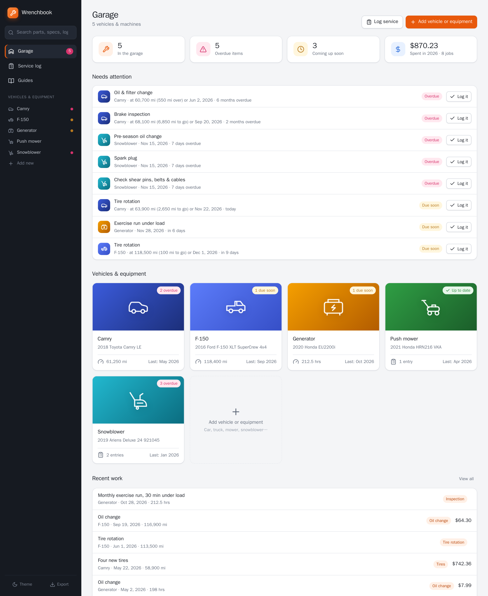

<sub>Screenshots use made-up demo data.</sub>

## Features

### Spec sheets
Each vehicle or machine gets editable sections:
- parts and part numbers
- fluids and capacities
- bolts, sockets and torque
- tires and wheels
- bulbs
- belts
- battery and electrical
- custom sections with any columns you like

Tap any value to copy it, which is handy at the parts counter. A spec sheet prints as a one-page reference for the
garage wall.

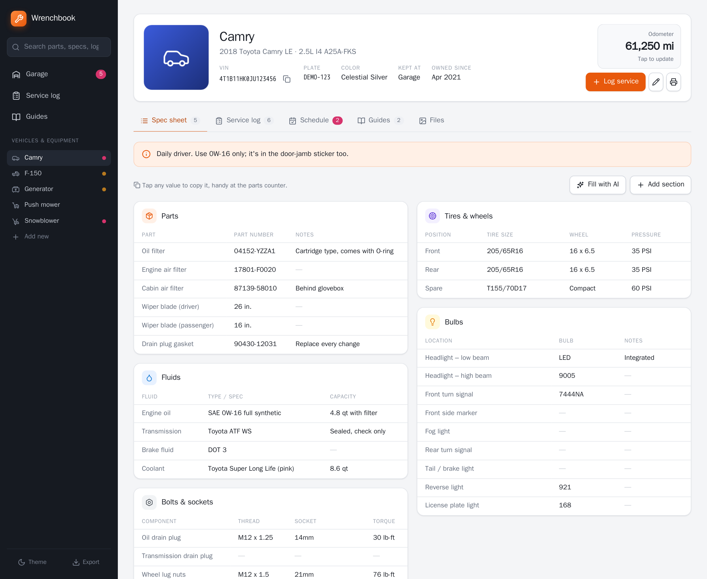

### Service log
Each entry records:
- date and odometer or hours
- category and who did the work
- cost
- parts used (part numbers autocomplete from the spec sheet)
- notes (Markdown works)
- photos and receipts

Entries are grouped by year, with spending totals. There's also a log for the whole garage with filters and search.

| Timeline | Logging an entry |
|---|---|
| 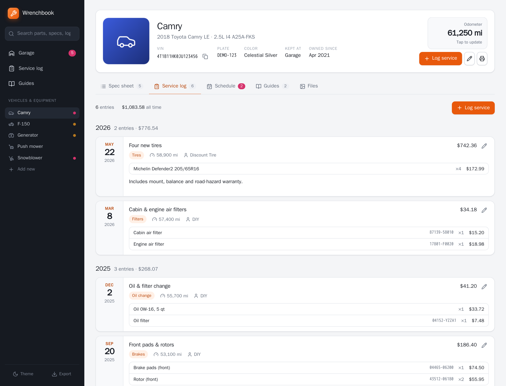 | 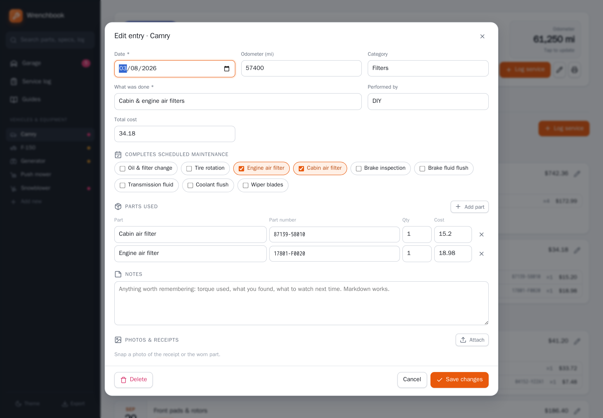 |

### Schedule
Service intervals like "every 5,000 mi or 6 months" can be set in miles, km, engine hours and/or months. Each one is
due at whichever limit comes first. Logging an entry against an interval resets it. The garage dashboard lists
everything that's overdue or coming up, with a one-click **Log it** button.

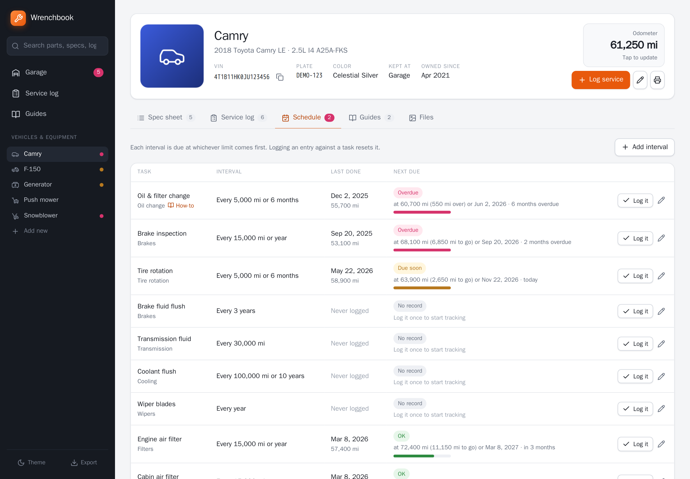

### Guides
Guides are your own repair manual: step-by-step how-tos with photos, checklists, warnings, torque tables, and tool and
part lists. A guide can be tied to specific machines or left general, and linked from a schedule item.

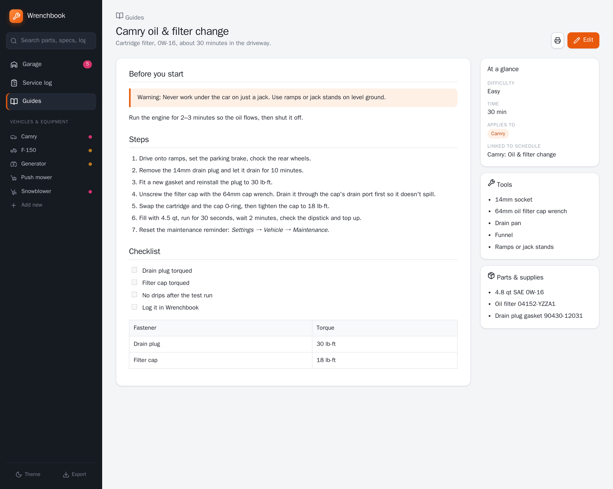

### VIN decode and AI fill
- **VIN decode:** enter a VIN when adding a vehicle and click **Decode**. Year, make, model, trim and engine come from
  NHTSA's free vPIC database, and the right kind (car, truck, van…) is picked for you. No API key needed.
- **Fill with AI:** copy a prompt written for that vehicle into ChatGPT, Claude or anything else, then paste the JSON
  reply back. You preview the changes before importing. By default only blanks get filled in, and the AI's sources
  are saved in the vehicle's notes. Wrenchbook itself has no API key or AI integration.
- **Agents:** `/llms.txt` documents the JSON API, so an AI agent that can make web requests can add vehicles, merge
  specs (with a dry run first), log service and upload manuals.

| VIN decode | Fill with AI |
|---|---|
| 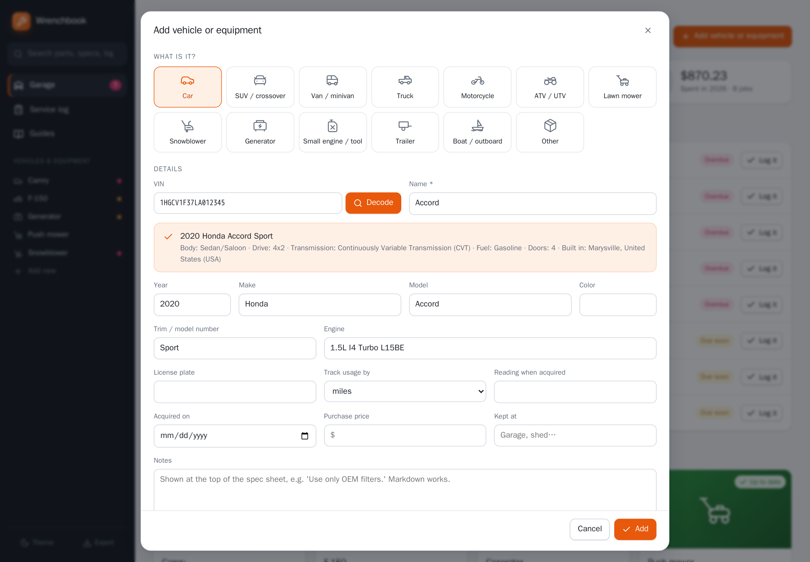 | 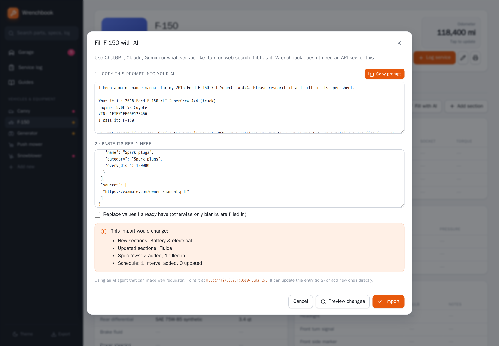 |

### Everything else
- **Templates for each kind.** A new snowblower starts with shear pins, belts, spark plug and pre-season tasks; a new
  car starts with filters, fluids, bulbs and the usual intervals. All of it is editable.
- **Files:** photos, receipts and PDF manuals for each machine, plus a cover photo.
- **Search** covers part numbers, bulbs, fluids, VINs, past jobs and guides. Search `7443` to see every vehicle that
  uses that bulb.
- **Light and dark themes**, and a phone layout with a bottom nav bar for use in the garage.

| Phone | Phone | Phone (dark) |
|---|---|---|
| 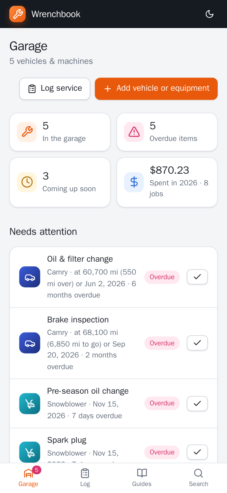 | 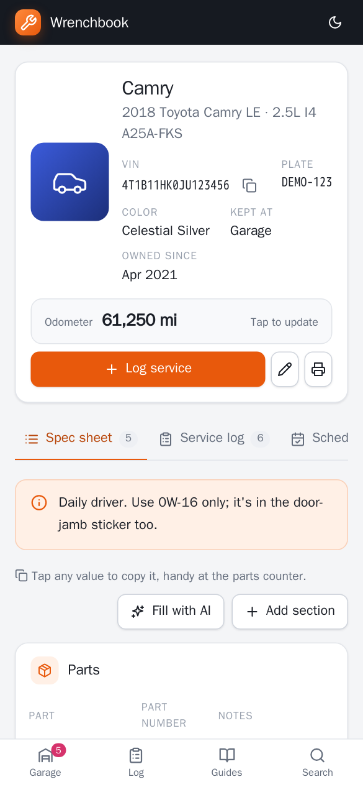 | 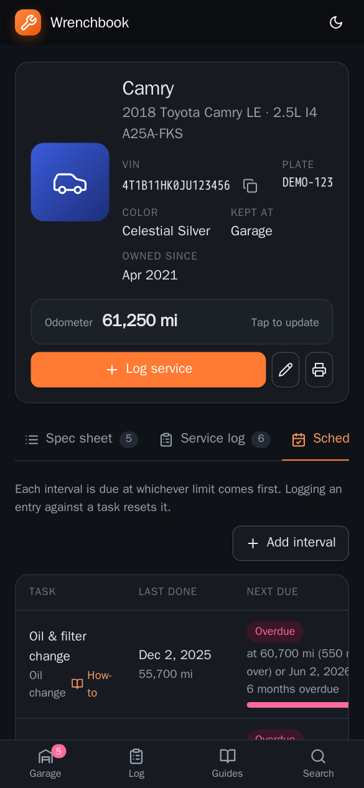 |

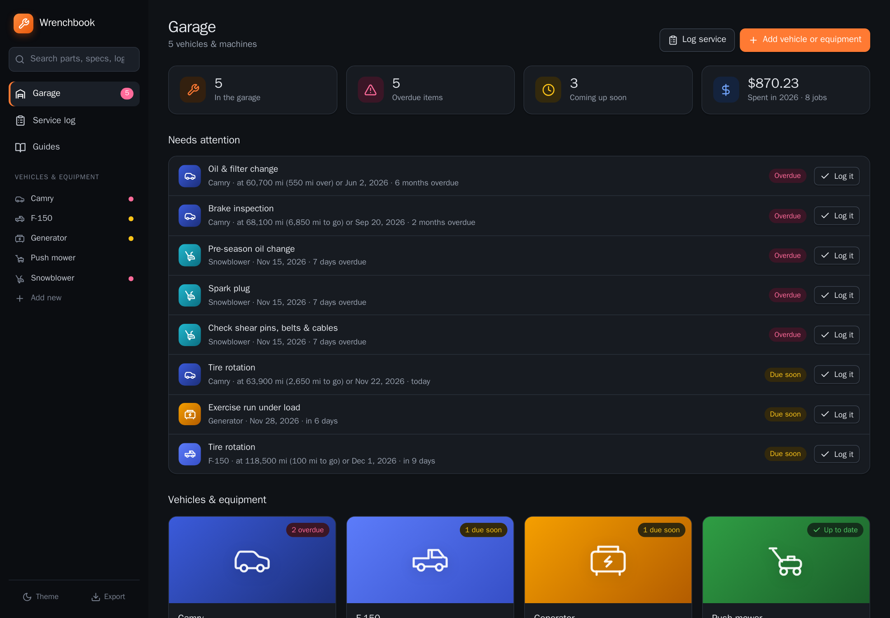

Everything runs in one small container: FastAPI, plain JS with no build step, and SQLite.

## Deploy

```sh
git clone http://git.proxub/billy/wrenchbook.git
cd wrenchbook
cp .env.example .env             # optional: set WRENCHBOOK_PASSWORD
mkdir -p data                    # or restore a backed-up data/ here first
docker compose up -d --build     # http://<host>:8300
```

The container runs as uid 1000, so `data/` must be writable by that user.
To update: `git pull && docker compose up -d --build`.

To move to another PC, copy `data/` across (stop the container first so the SQLite DB is consistent).

## State NOT in this repo

| What | Where | Notes |
|---|---|---|
| **`data/`** | `./data` → `/data` | `wrenchbook.db` (everything) and `files/` (uploads). Gitignored. **Back it up.** |
| **UI password** (optional) | `.env` → `WRENCHBOOK_PASSWORD=` | Empty = no login (LAN only). Basic auth, any username. |
| **Reverse proxy** | Nginx Proxy Manager | Not set up yet. |

`/api/export` (the **Export** button in the sidebar) downloads a JSON dump of the database. It doesn't include uploaded files.
VIN decode needs outbound internet access to `vpic.nhtsa.dot.gov`.
